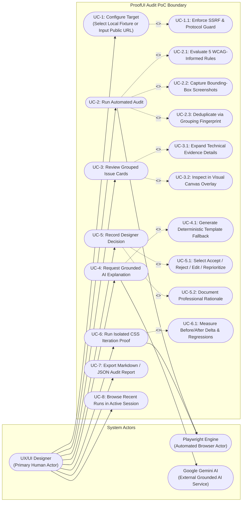
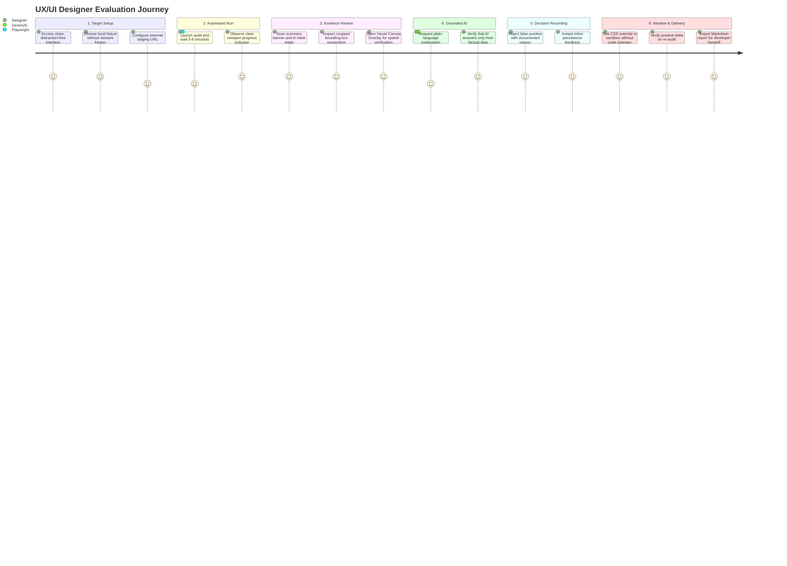
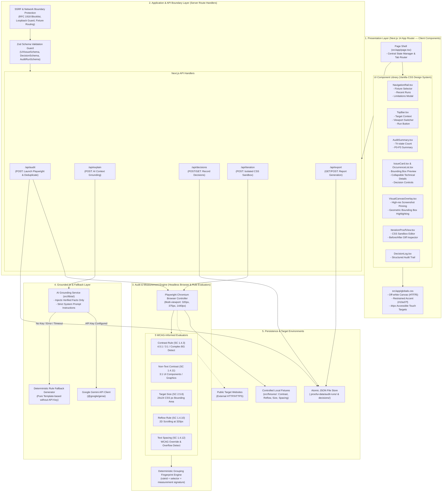
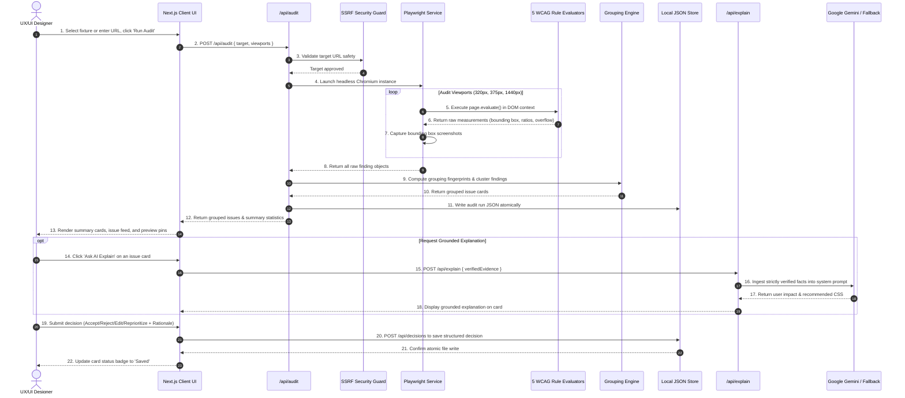

# System Architecture & Diagrams — ProofUI Audit PoC

> **System Architecture, Use Case Diagram, User Flow Diagram, and End-to-End Design Reference**  
> For the research prototype: `proofui-audit-poc` (Evidence-Based UX/UI Optimization with Designer-in-the-Loop Validation).  
> 🌐 **Language**: English | [ภาษาไทย](ARCHITECTURE.th.md)

---

## 📑 Table of Contents

1. [System Overview & Design Philosophy](#1-system-overview--design-philosophy)
2. [Use Case Diagram & Actor Specifications](#2-use-case-diagram--actor-specifications)
   - [2.1 Use Case Diagram](#21-use-case-diagram)
   - [2.2 Actor Specifications](#22-actor-specifications)
   - [2.3 Core Use Case Descriptions](#23-core-use-case-descriptions)
3. [User Diagram: Persona, User Flow & Journey Map](#3-user-diagram-persona-user-flow--journey-map)
   - [3.1 Target Persona](#31-target-persona)
   - [3.2 User Flow Diagram](#32-user-flow-diagram)
   - [3.3 User Journey Map](#33-user-journey-map)
4. [System Architecture Diagram (Component & Layered Design)](#4-system-architecture-diagram)
   - [4.1 Layered Architecture Diagram](#41-layered-architecture-diagram)
   - [4.2 Layer Descriptions](#42-layer-descriptions)
5. [Data Flow & Sequence Diagram](#5-data-flow--sequence-diagram)
   - [5.1 End-to-End Audit & Decision Sequence](#51-end-to-end-audit--decision-sequence)
6. [Security & Persistence Architecture](#6-security--persistence-architecture)
   - [6.1 SSRF Mitigation & Private Network Isolation](#61-ssrf-mitigation--private-network-isolation)
   - [6.2 Atomic File Write Storage Strategy](#62-atomic-file-write-storage-strategy)
7. [Codebase Mapping & Traceability Matrix](#7-codebase-mapping--traceability-matrix)

---

## 1. System Overview & Design Philosophy

**ProofUI Audit PoC** is an evidence-based research proof-of-concept designed for **UX/UI Designer-in-the-Loop Validation**.

Unlike conventional accessibility linters that produce opaque binary pass/fail scores or generative tools that hallucinate fixes, ProofUI Audit establishes a verifiable, deterministic loop connecting rendered browser measurements with human design decisions.

### Core Architectural Principles
1. **Deterministic Measurements**: All findings are computed directly from real rendered geometry and computed styles inside headless Chromium (Playwright) against 5 WCAG 2.2-informed criteria (`Text Contrast`, `Non-text Contrast`, `Target Size`, `Reflow`, and `Text Spacing`).
2. **Tri-State Status Discipline**: Every check outputs one of three explicit states:
   - `pass`: Unambiguously conforms to deterministic thresholds.
   - `candidateFail`: Factual measurement clearly breaches the criterion.
   - `needsReview`: Flags inherent contextual ambiguity (e.g., text across gradients/images, graphics with uncertain essential purpose, or complex table reflow) to prevent overclaiming conformance.
3. **Designer-in-the-Loop Autonomy**: The system is strictly a decision-support instrument. Designers retain full sovereignty to `Accept`, `Reject`, `Edit`, or `Reprioritize` findings with recorded rationales.
4. **Grounded AI with Fallback**: The AI engine receives exclusively verified factual evidence (bounding boxes, measured values, selectors) via a single unified provider abstraction (Google Gemini) and automatically falls back to deterministic template generation when offline or when no API key is configured.

---

## 2. Use Case Diagram & Actor Specifications

### 2.1 Use Case Diagram



---

### 2.2 Actor Specifications

| Actor | Category | Responsibilities & System Interactions |
|---|---|---|
| **UX/UI Designer** | Human (Primary) | Initiates audits, inspects visual & geometric evidence, consults AI recommendations, validates or overrules candidate issues (`Accept`, `Reject`, `Edit`, `Reprioritize`), simulates CSS overrides, and exports compliance reports. |
| **Playwright Engine** | System / Automated | Runs headless Chromium instances, dynamically resizes viewports (`320px`, `375px`, `1440px`), evaluates in-browser DOM layout geometry and color luminance, and captures cropped element screenshots. |
| **Google Gemini AI** | External Service | Ingests verified measurement facts via strict JSON schema prompt boundaries to explain user impact and propose CSS remedies without fabricating unmeasured data. |

---

### 2.3 Core Use Case Descriptions

| ID | Use Case Name | Preconditions | Trigger & Workflow | Postconditions |
|---|---|---|---|---|
| **UC-1** | Configure Audit Target | Application is running on port 3123 | User picks a local fixture category or enters a public HTTP/HTTPS URL. | Target is validated against SSRF blocklists and readied for execution. |
| **UC-2** | Run Automated Audit | Valid target is selected | User clicks "Run Audit". Playwright evaluates DOM across 3 viewports, captures screenshots, and hashes findings into fingerprints. | Raw findings and grouped issues are saved to `.proofui-data/audit-runs/` and rendered in UI. |
| **UC-3** | Review Grouped Issue Cards | Audit run completed | Designer navigates through issue cards, toggles technical evidence, or launches full-screen Visual Canvas Overlay. | Visual highlights and numerical measurements are clearly inspected. |
| **UC-4** | Request Grounded Explanation | Issue card displayed | User clicks "Ask AI Explain". Engine feeds evidence to Gemini (or triggers deterministic fallback). | Grounded impact explanation and suggested CSS are appended to the issue card. |
| **UC-5** | Record Designer Decision | Issue card displayed | Designer chooses `Accept`, `Reject`, `Edit`, or `Reprioritize` and inputs rationale. | Decision is committed atomically to `.proofui-data/decisions/` with immediate UI confirmation. |
| **UC-6** | Run CSS Iteration Proof | Local fixture issue selected | Designer inputs custom or preset CSS overrides in Iteration Proof tab and triggers re-audit. | Isolated preview renders live without altering source files; Before/After deltas are computed. |
| **UC-7** | Export Reports | Audit run with decisions exists | Designer clicks Export Markdown or Export JSON. | Browser downloads structured report with evidence, decisions, and disclaimers. |

---

## 3. User Diagram: Persona, User Flow & Journey Map

### 3.1 Target Persona

* **Persona**: Alex Chen (Lead UX/UI Designer & Accessibility Advocate)
* **Goal**: Validate that design token updates and components meet WCAG 2.2 criteria across viewports before engineering sign-off.
* **Key Challenges**:
  * Off-the-shelf automated linters lack geometric bounding-box evidence and create false positives.
  * Generic generative AI models produce hallucinations and inaccurate CSS selectors.
  * Needs clear documentation of intentional design trade-offs (e.g., why a graphical item was marked as an exception).

---

### 3.2 User Flow Diagram

```mermaid
flowchart TD
    Start([Launch ProofUI Application]) --> InitialDashboard[Display Dashboard with Fixture Selector]
    InitialDashboard --> SelectTargetMode{Select Target Source}
    
    SelectTargetMode -->|Local Fixture Recommended| SelectFixture[Choose Test Fixture Category<br/>Target Size / Contrast / Reflow / Spacing]
    SelectTargetMode -->|Public URL| InputURL[Enter External Public URL]
    
    InputURL --> ValidateSSRF{SSRF & Scheme Check}
    ValidateSSRF -->|Private IP / Invalid Scheme| ShowError[Display Security Error Banner] --> InputURL
    ValidateSSRF -->|Valid Target| ReadyState
    SelectFixture --> ReadyState[Target Ready for Inspection]

    ReadyState --> ExecuteAudit[Click 'Run Audit']
    ExecuteAudit --> AuditLoading[Display Loading State & Progress<br/>Playwright audits 320px, 375px, 1440px]
    
    AuditLoading --> RenderResults[Display Summary Banner & Grouped Issue Feed]
    RenderResults --> BrowseCards[Select Grouped Issue Card to Inspect]

    subgraph InspectionLayer ["Evidence Inspection Phase"]
        BrowseCards --> ViewHeader[Review Title, Tri-state Status, and Priority P0-P3]
        ViewHeader --> BranchInspect{Inspect Detail Level}
        BranchInspect -->|Technical Evidence| ExpandTech[Expand Selector, Bounding Box, and Measurement Deltas]
        BranchInspect -->|Spatial Context| LaunchOverlay[Open Visual Canvas Overlay for Full-page Pinning]
        BranchInspect -->|AI Assistance| RequestAI[Click 'Ask AI Explain']
        RequestAI --> RenderAIText[Review Grounded Explanation or Deterministic Fallback]
    end

    subgraph DecisionLayer ["Designer-in-the-Loop Decision Phase"]
        RenderAIText --> MakeDecision[Select Decision Action: Accept / Reject / Edit / Reprioritize]
        ExpandTech --> MakeDecision
        LaunchOverlay --> MakeDecision
        
        MakeDecision --> InputRationale[Enter Designer Rationale]
        InputRationale --> SaveDecision[Click 'Save Decision']
        SaveDecision --> PersistCheck{Atomic Write Successful?}
        PersistCheck -->|Failed| PreserveDraft[Preserve Input Draft & Show Error] --> InputRationale
        PersistCheck -->|Success| ShowSavedBadge[Display Inline 'Saved' Indicator]
    end

    ShowSavedBadge --> CheckIteration{Verify Candidate Fix?}
    
    CheckIteration -->|Yes on Local Fixture| OpenSandbox[Navigate to Iteration Proof Tab]
    OpenSandbox --> ApplyOverride[Select or Type CSS Override]
    ApplyOverride --> ReAudit[Click 'Test Override' in Isolated Sandbox]
    ReAudit --> CompareDelta[Inspect Before vs After Metrics & Regression Results]
    CompareDelta --> CheckExport
    
    CheckIteration -->|No| CheckExport{Export Findings?}
    
    CheckExport -->|Export Markdown| DownloadMD[Download .md Report]
    CheckExport -->|Export JSON| DownloadJSON[Download .json Data]
    CheckExport -->|Complete| EndFlow([Workflow Complete])
    DownloadMD --> EndFlow
    DownloadJSON --> EndFlow
```



---

### 3.3 User Journey Map



---

## 4. System Architecture Diagram

### 4.1 Layered Architecture Diagram



---

### 4.2 Layer Descriptions

1. **Presentation Layer (Frontend)**:
   - Built on Next.js 14 App Router, React, and pure CSS custom properties (`globals.css`).
   - Zero heavy styling frameworks (Tailwind, MUI, or Radix are completely omitted to ensure a lean footprint and deterministic rendering).
   - Interactive elements enforce accessible **>=44×44 CSS px touch targets** with persistent focus indicators.
2. **API & Security Boundary Layer**:
   - `SSRF Guard` validates external URLs against private RFC 1918 subnets, cloud metadata IPs, and loopback addresses.
   - **Zod schemas** strictly validate all JSON payloads at API request and response boundaries.
3. **Audit & Measurement Engine**:
   - Manages headless Chromium via Playwright across `320px`, `375px`, and `1440px` viewports.
   - Evaluates real DOM bounding boxes, subpixel geometry, and color contrast ratios using 5 deterministic evaluators.
   - Computes a deterministic hash fingerprint (`ruleId + selector + normalized measurement signature`) to group identical cross-viewport issues.
4. **Grounded AI & Fallback Layer**:
   - Wraps Google Gemini (`@google/genai`) within an evidence-only prompt contract.
   - If `GEMINI_API_KEY` is omitted or calls fail, seamlessly switches to the **Deterministic Template Fallback**, ensuring 100% offline functionality.
5. **Persistence Layer**:
   - Avoids native SQLite C-bindings by using a local JSON file store under `.proofui-data/`.
   - All writes are executed **atomically** (writing to temporary files and renaming) to prevent corruption during concurrent operations.

---

## 5. Data Flow & Sequence Diagram

### 5.1 End-to-End Audit & Decision Sequence



---

## 6. Security & Persistence Architecture

### 6.1 SSRF Mitigation & Private Network Isolation
To prevent Server-Side Request Forgery (SSRF) when evaluating public external targets:
* **Strict Protocol Allowlist**: Only `http:` and `https:` schemes are accepted.
* **RFC 1918 Blocklist**: All private IP ranges are blocked (`10.0.0.0/8`, `172.16.0.0/12`, `192.168.0.0/16`).
* **Loopback & Cloud Metadata Guard**: Addresses such as `127.0.0.1`, `localhost`, and link-local `169.254.169.254` are prohibited.
* **Internal Fixture Protocol**: Local test fixtures bypass public networking via internal routes (`src/fixtures/`), preventing internal port-scanning.

### 6.2 Atomic File Write Storage Strategy
Data is persisted in the `.proofui-data/` directory:
* `.proofui-data/audit-runs/<run-id>.json`: Contains audit metadata, viewports, raw findings, and grouped issues.
* `.proofui-data/decisions/<decision-id>.json`: Contains designer decisions, rationales, and timestamps.

All write operations follow an **Atomic Write Pattern**:
```text
Write payload to `<file>.tmp.<timestamp>` -> fs.renameSync(tempFile, targetFile)
```
This guarantees that concurrent reads never observe partially written or corrupt JSON files.

---

## 7. Codebase Mapping & Traceability Matrix

| Architectural Subsystem | Source Path | Primary Role |
|---|---|---|
| **Presentation Page Shell** | [`src/app/page.tsx`](../src/app/page.tsx) | Central state orchestrator and tab navigation router |
| **CSS Tokens & Design System** | [`src/app/globals.css`](../src/app/globals.css) | Color tokens, surface variables, and 44px touch targets |
| **Issue Card Component** | [`src/components/IssueCard.tsx`](../src/components/IssueCard.tsx) | Issue card hierarchy, evidence toggles, and decision forms |
| **Visual Canvas Overlay** | [`src/components/VisualCanvasOverlay.tsx`](../src/components/VisualCanvasOverlay.tsx) | Full-screen screenshot overlay with spatial bounding boxes |
| **Iteration Sandbox View** | [`src/components/IterationProofView.tsx`](../src/components/IterationProofView.tsx) | Isolated CSS override editor and Before/After delta preview |
| **Audit API Handler** | [`src/app/api/audit/route.ts`](../src/app/api/audit/route.ts) | Playwright orchestration endpoint and result grouping |
| **Explain API Handler** | [`src/app/api/explain/route.ts`](../src/app/api/explain/route.ts) | Grounded AI explanation endpoint |
| **Decisions API Handler** | [`src/app/api/decisions/route.ts`](../src/app/api/decisions/route.ts) | Designer decision persistence endpoint |
| **Target Size Evaluator** | [`src/lib/audit/rules/target-size.ts`](../src/lib/audit/rules/target-size.ts) | 24×24 CSS px bounding box measurement logic |
| **Contrast Evaluators** | [`src/lib/audit/rules/contrast.ts`](../src/lib/audit/rules/contrast.ts) | Text & non-text luminance math and complex BG detection |
| **Reflow & Spacing Evaluators** | [`src/lib/audit/rules/reflow.ts`](../src/lib/audit/rules/reflow.ts) | 320px 2D scroll detection and spacing override check |
| **Grouping Engine** | [`src/lib/audit/grouping.ts`](../src/lib/audit/grouping.ts) | Deterministic grouping fingerprint calculator |
| **AI Grounding & Fallback** | [`src/lib/ai/gemini.ts`](../src/lib/ai/gemini.ts) | Google Gemini client and deterministic template fallback |
| **Local File Store** | [`src/lib/storage/json-store.ts`](../src/lib/storage/json-store.ts) | Atomic JSON file read/write operations |
| **Zod Schemas** | [`src/lib/schema/audit.ts`](../src/lib/schema/audit.ts) | Runtime schema validation for issues, runs, and decisions |
