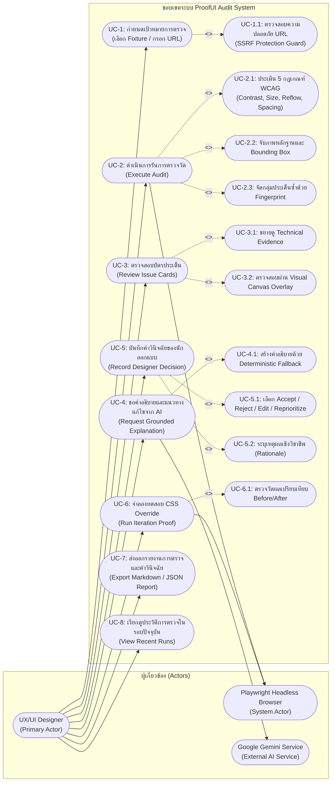
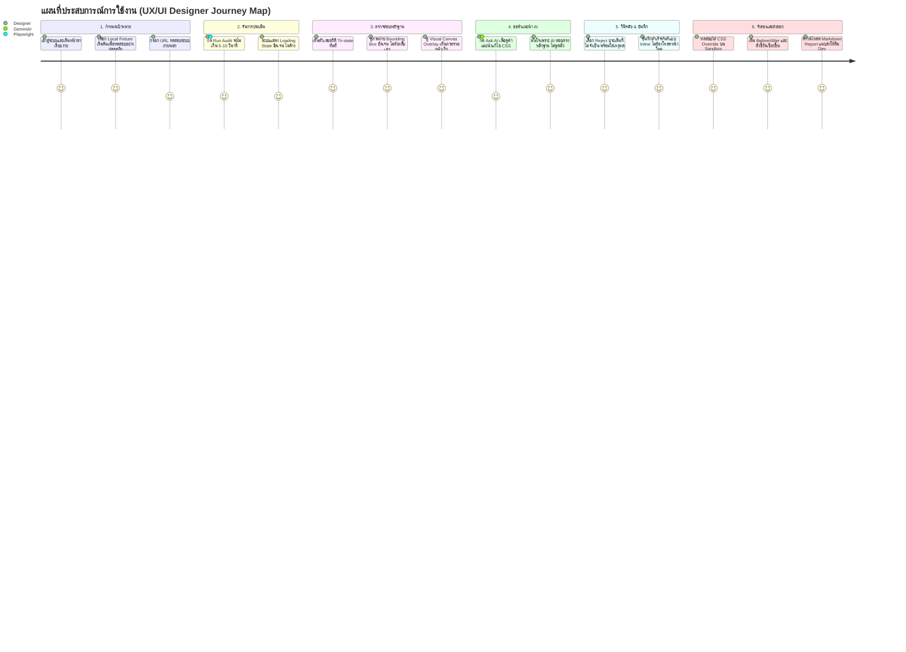
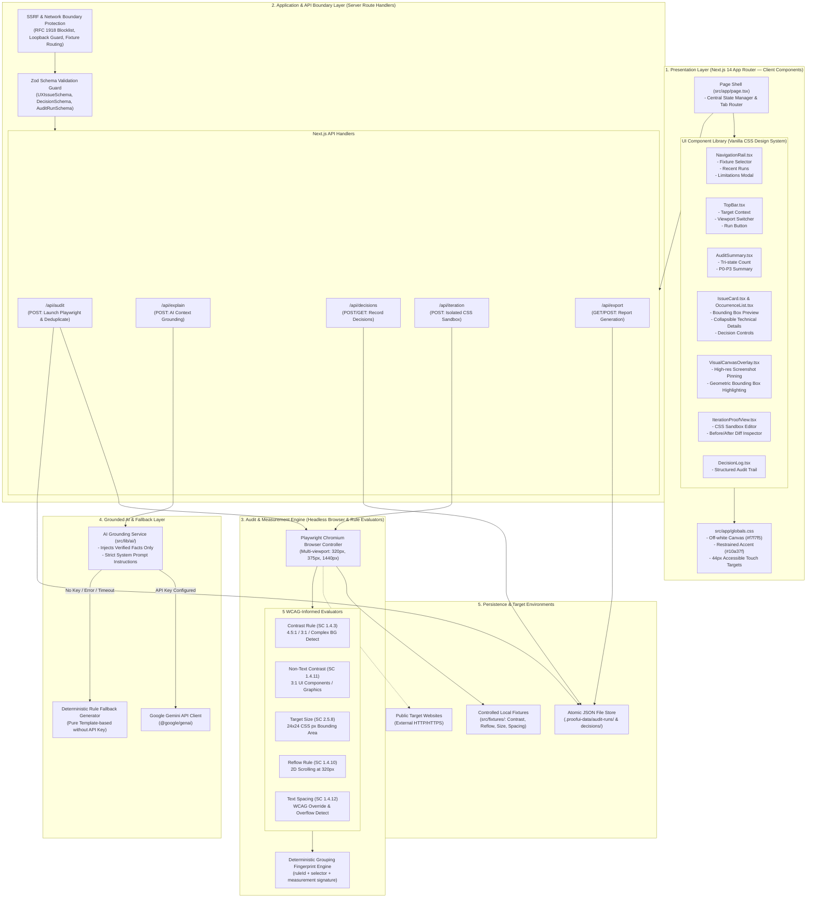
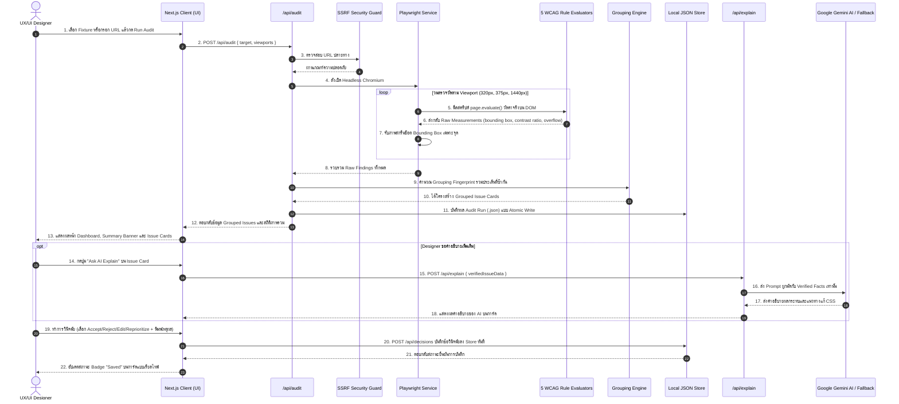

# System Architecture & Diagrams — ProofUI Audit PoC

> **เอกสารสถาปัตยกรรมระบบ, Use Case Diagram, User Flow Diagram และ System Architecture**  
> สำหรับโครงการวิจัย `proofui-audit-poc`: Evidence-Based UX/UI Optimization with Designer-in-the-Loop Validation  
> 🌐 **Language**: ภาษาไทย | [English Version](ARCHITECTURE.md)

---

## 📑 สารบัญ

1. [ภาพรวมระบบและปรัชญาการออกแบบ (System Overview & Design Philosophy)](#1-ภาพรวมระบบและปรัชญาการออกแบบ)
2. [Use Case Diagram และรายละเอียดฟังก์ชัน (Use Case Diagram & Specs)](#2-use-case-diagram-และรายละเอียดฟังก์ชัน)
   - [2.1 แผนภาพ Use Case Diagram](#21-แผนภาพ-use-case-diagram)
   - [2.2 ตารางระบุบทบาทของผู้เกี่ยวข้อง (Actor Specifications)](#22-ตารางระบุบทบาทของผู้เกี่ยวข้อง-actor-specifications)
   - [2.3 คำอธิบายกรณีการใช้งานหลัก (Use Case Details)](#23-คำอธิบายกรณีการใช้งานหลัก-use-case-details)
3. [User Diagram: Persona, User Flow และ User Journey](#3-user-diagram-persona-user-flow-และ-user-journey)
   - [3.1 ข้อมูลกลุ่มผู้ใช้เป้าหมาย (Target Persona)](#31-ข้อมูลกลุ่มผู้ใช้เป้าหมาย-target-persona)
   - [3.2 แผนภาพลำดับการทำงานของผู้ใช้ (User Flow Diagram)](#32-แผนภาพลำดับการทำงานของผู้ใช้-user-flow-diagram)
   - [3.3 แผนที่ประสบการณ์การใช้งาน (User Journey Map)](#33-แผนที่ประสบการณ์การใช้งาน-user-journey-map)
4. [System Architecture Diagram (สถาปัตยกรรมระบบเชิงโครงสร้าง)](#4-system-architecture-diagram)
   - [4.1 แผนภาพสถาปัตยกรรมแบบแบ่งระดับ (Layered Architecture Diagram)](#41-แผนภาพสถาปัตยกรรมแบบแบ่งระดับ-layered-architecture-diagram)
   - [4.2 คำอธิบายสถาปัตยกรรมแต่ละระดับ (Layer Descriptions)](#42-คำอธิบายสถาปัตยกรรมแต่ละระดับ-layer-descriptions)
5. [Data Flow & Sequence Diagram (ขั้นตอนการทำงานเชิงปฏิสัมพันธ์)](#5-data-flow--sequence-diagram)
   - [5.1 ลำดับการทำงานตั้งแต่เริ่ม Audit จนถึงบันทึกผล (End-to-End Sequence Diagram)](#51-ลำดับการทำงานตั้งแต่เริ่ม-audit-จนถึงบันทึกผล)
6. [Security & Storage Architecture (ความปลอดภัยและระบบจัดเก็บข้อมูล)](#6-security--storage-architecture)
   - [6.1 การป้องกัน SSRF & Localhost Isolation](#61-การป้องกัน-ssrf--localhost-isolation)
   - [6.2 Atomic File Write Persistence Model](#62-atomic-file-write-persistence-model)
7. [การเชื่อมโยงโครงสร้างไฟล์ (Code Mapping & Architecture Traceability)](#7-การเชื่อมโยงโครงสร้างไฟล์-code-mapping)

---

## 1. ภาพรวมระบบและปรัชญาการออกแบบ

**ProofUI Audit PoC** เป็นระบบต้นแบบการวิจัย (Research Proof-of-Concept) สำหรับการปรับปรุงคุณภาพ UX/UI โดยอิงหลักฐานเชิงประจักษ์และการมีส่วนร่วมของนักออกแบบ (**Evidence-Based UX/UI Optimization with Designer-in-the-Loop Validation**)

### ปรัชญาและข้อกำหนดหลัก (Core Principles)
1. **Deterministic Measurements**: ทุกข้อค้นพบต้องมีหลักฐานตัวเลขเชิงเรขาคณิตหรือค่าสีที่วัดได้จริงจากเบราว์เซอร์ Headless (Playwright) ผ่าน 5 กฎเกณฑ์ตามแนวทาง WCAG 2.2 (`Text Contrast`, `Non-text Contrast`, `Target Size`, `Reflow`, `Text Spacing`)
2. **Tri-State Status**: ไม่ตัดสินแบบ Binary (Pass/Fail) อย่างหยาบกระด้าง แต่ใช้สถานะสามระดับ:
   - `pass` — ผ่านเกณฑ์ชัดเจน
   - `candidateFail` — มีหลักฐานเชิงตัวเลขที่ตกเกณฑ์ชัดเจน
   - `needsReview` — มีความกำกวมในระดับ Context (เช่น ตัวหนังสือบนพื้นหลัง Gradient, กราฟิกที่อาจเข้าข้อยกเว้น WCAG) เพื่อไม่เคลมเกินจริง
3. **Designer-in-the-Loop Autonomy**: ระบบและ AI ไม่ทำการตัดสินใจแทนมนุษย์ แต่ทำหน้าที่เป็น "ผู้ช่วยสนับสนุนการตัดสินใจ" (Decision Support Tool) สิทธิ์ในการกด `Accept`, `Reject`, `Edit` หรือ `Reprioritize` พร้อมบันทึกเหตุผล เป็นของนักออกแบบ 100%
4. **Grounded AI with Deterministic Fallback**: AI ได้รับข้อมูลเฉพาะหลักฐานที่วัดได้จริงเท่านั้น (Verified Evidence Only) ป้องกันปัญหาข้อมูลหลอน (Hallucination) และมีระบบ Fallback อัตโนมัติเมื่อไม่มีการตั้งค่า `GEMINI_API_KEY` ทำให้ระบบทำงานแบบ Offline ได้สมบูรณ์

---

## 2. Use Case Diagram และรายละเอียดฟังก์ชัน

### 2.1 แผนภาพ Use Case Diagram

---

### 2.2 ตารางระบุบทบาทของผู้เกี่ยวข้อง (Actor Specifications)

| Actor | ประเภท | บทบาทและความรับผิดชอบในระบบ |
|---|---|---|
| **UX/UI Designer** | Human (Primary) | ผู้ใช้งานหลัก มีหน้าที่เลือกเป้าหมาย, สั่งรันการตรวจ, วิเคราะห์หลักฐานจากบัตรประเด็น, ขอคำปรึกษาจาก AI, บันทึกคำวินิจฉัยเชิงวิชาชีพ (`Accept`/`Reject`/`Edit`/`Reprioritize`) และส่งออกรายงาน |
| **Playwright Engine** | System / Automated | รันเบราว์เซอร์ Headless Chromium ในเบื้องหลัง ควบคุมขนาด Viewport (320px, 375px, 1440px), วัดค่าพิกัด DOM และสไตล์ที่แท้จริง, และถ่ายภาพ Bounding Box |
| **Google Gemini AI** | External Service | รับเฉพาะโครงสร้างข้อมูลหลักฐานที่ยืนยันแล้ว (`Verified Evidence`) เพื่อสรุปผลกระทบต่อผู้ใช้งานและแนะนำแนวทางแก้ไข CSS โดยไม่กุข้อมูล |

---

### 2.3 คำอธิบายกรณีการใช้งานหลัก (Use Case Details)

| รหัส Use Case | ชื่อ Use Case | Preconditions | Trigger & Actions | Postconditions |
|---|---|---|---|---|
| **UC-1** | กำหนดเป้าหมายการตรวจ | ผู้ใช้เปิดหน้าเว็บระบบ | ผู้ใช้เลือก Local Fixture หรือกรอก URL ภายนอก | ระบบตรวจสอบความถูกต้องผ่าน SSRF Guard หากถูกต้องจะพร้อมสั่งรัน |
| **UC-2** | ดำเนินการรันการตรวจวัด | มีเป้าหมายที่ถูกต้อง | ผู้ใช้คลิกปุ่ม "Run Audit" | Playwright รันการประเมิน 5 กฎเกณฑ์, จับภาพ, จัดกลุ่มด้วย Fingerprint และบันทึกลง Store |
| **UC-3** | ตรวจสอบบัตรประเด็น | ผลการตรวจวัดพร้อมแสดงผล | ผู้ใช้เปิดดูการ์ดประเด็น, ฟิลเตอร์สถานะ หรือสลับไปดู Visual Canvas Overlay | ผู้ใช้เห็นพิกัด, ค่าสี, ตัวเลขวัดผลจริง และภาพประกอบชัดเจน |
| **UC-4** | ขอคำอธิบาย AI Grounding | อยู่ในหน้าบัตรประเด็นใดๆ | ผู้ใช้กดปุ่ม "Ask AI Explain" | ระบบส่ง Evidence ไปยัง Gemini หรือใช้ Deterministic Template Fallback และแสดงคำแนะนำ |
| **UC-5** | บันทึกคำวินิจฉัย Designer | อยู่ในการ์ดประเด็น | ผู้ใช้เลือกสถานะการตัดสินใจ และพิมพ์เหตุผลประกอบ | ข้อมูลถูกบันทึกลง `.proofui-data/` แบบ Atomic ทันที พร้อมแสดงสถานะยืนยัน |
| **UC-6** | จำลองทดสอบ CSS Override | เลือกประเด็นบน Local Fixture | ผู้ใช้ไปที่แท็บ Iteration Proof ป้อนโค้ด CSS และสั่งรัน | ระบบรัน Isolated Preview และเปรียบเทียบผลลัพธ์ Before/After ชี้วัดว่าแก้สำเร็จหรือไม่ |
| **UC-7** | ส่งออกรายงานผล | มีข้อมูล Audit Run | ผู้ใช้เลือก Export Markdown หรือ JSON | เบราว์เซอร์ดาวน์โหลดไฟล์รายงานที่ระบุข้อค้นพบ คำตัดสินใจ และคำประกาศข้อจำกัด |

---

## 3. User Diagram: Persona, User Flow และ User Journey

### 3.1 ข้อมูลกลุ่มผู้ใช้เป้าหมาย (Target Persona)

* **ชื่อตัวแทน (Persona Name)**: คุณนภัส (Senior UX/UI Designer & Accessibility Champion)
* **บริบทงาน**: ดูแล Design System และประสานงานกับทีม Front-end Developer ก่อน Release ชิ้นงานสู่ Production
* **ความต้องการ**:
  * ต้องการผลการตรวจที่ "ชี้เป้าแม่นยำ" (Selector ชัดเจน, พิกัด Bounding Box ชัดเจน)
  * ไม่ต้องการเครื่องมือ AI ที่ตอบคลุมเครือหรือประดิษฐ์กฎเกณฑ์ขึ้นเอง
  * ต้องการบันทึกเหตุผลทางดีไซน์ (Design Rationale) เพื่อใช้สื่อสารต่อในทีม
  * ต้องการทดสอบสมมติฐานการแก้ CSS ได้ทันทีโดยไม่ต้องรบกวน Production Code

---

### 3.2 แผนภาพลำดับการทำงานของผู้ใช้ (User Flow Diagram)

```mermaid
flowchart TD
    Start([เข้าสู่ระบบ ProofUI Audit]) --> ScreenInit[แสดงหน้า Dashboard ว่าง พร้อมตัวเลือก Fixture]
    ScreenInit --> ChooseMode{เลือกรูปแบบเป้าหมาย}
    
    ChooseMode -->|Local Fixture แนะนำ| SelectFix[เลือกหมวดหมู่ Fixture เช่น Contrast / Size / Reflow]
    ChooseMode -->|Public URL| InputURL[กรอก URL ของเว็บไซต์ที่ต้องการ]
    
    InputURL --> ValidateURL{ตรวจสอบความถูกต้อง & SSRF}
    ValidateURL -->|ไม่ผ่าน เช่น Private IP/Localhost| ShowURLError[แสดงข้อความแจ้งเตือนข้อผิดพลาด] --> InputURL
    ValidateURL -->|ผ่านเกณฑ์ความปลอดภัย| ReadyAudit
    SelectFix --> ReadyAudit[พร้อมเริ่มการตรวจสอบ]

    ReadyAudit --> TriggerAudit[กดปุ่ม Run Audit]
    TriggerAudit --> WaitingAudit[ระบบแสดงสถานะ Loading<br/>Playwright ตรวจสอบ 3 Viewports: 320, 375, 1440px]
    
    WaitingAudit --> AuditResult[แสดงผลลัพธ์: Summary Banner และ รายการ Grouped Issue Cards]
    
    AuditResult --> SelectCard[เลือกดูบัตรประเด็นที่สนใจ]
    
    subgraph InspectionPhase ["ขั้นตอนการตรวจสอบหลักฐาน"]
        SelectCard --> ViewBasic[อ่านข้อความสรุป, สถานะ Tri-state, และ Priority P0-P3]
        ViewBasic --> ToggleDetail{ต้องการดูข้อมูลเชิงลึก?}
        ToggleDetail -->|ขยายข้อมูล| ExpandTech[ดู Selector, Bounding Box, และค่าที่วัดได้จริง]
        ToggleDetail -->|ดูภาพรวม| OpenOverlay[เปิด Visual Canvas Overlay เพื่อดูตำแหน่งบนหน้าจอ]
        ToggleDetail -->|ขอคำปรึกษา| AskAI[กดปุ่ม Ask AI เพื่อขอคำอธิบายและข้อเสนอแนะ]
        AskAI --> RenderAI[อ่านคำอธิบาย Grounded AI หรือ Template Fallback]
    end

    subgraph DecisionPhase ["ขั้นตอนการตัดสินใจของ Designer"]
        RenderAI --> ActionDecision[เลือกคำวินิจฉัย: Accept / Reject / Edit / Reprioritize]
        ExpandTech --> ActionDecision
        OpenOverlay --> ActionDecision
        
        ActionDecision --> FillReason[ระบุเหตุผลในการตัดสินใจ]
        FillReason --> SaveBtn[กดปุ่ม Save Decision]
        SaveBtn --> PersistCheck{บันทึกลง Local Store สำเร็จ?}
        PersistCheck -->|ล้มเหลว| KeepDraft[รักษาร่างข้อความไว้ แจ้งเตือนข้อผิดพลาด] --> FillReason
        PersistCheck -->|สำเร็จ| MarkSaved[แสดง Badge สถานะว่าบันทึกแล้วในการ์ด]
    end

    MarkSaved --> NextStep{ต้องการจำลองผลการแก้ไข CSS?}
    
    NextStep -->|ใช่ ทดสอบบน Local Fixture| IterationFlow[เปิดแท็บ Iteration Proof]
    IterationFlow --> ApplyCSS[เลือกหรือกรอก CSS Override]
    ApplyCSS --> Reaudit[กดปุ่ม Test Override เพื่อ Re-audit แบบแยกส่วน]
    Reaudit --> CompareResult[ดูเปรียบเทียบ Before vs After และผลการเกิด Regression]
    CompareResult --> ExportCheck
    
    NextStep -->|ไม่ใช่| ExportCheck{ต้องการนำรายงานไปใช้งาน?}
    
    ExportCheck -->|ส่งออก Markdown| ExportMD[ดาวน์โหลดไฟล์ Markdown Report]
    ExportCheck -->|ส่งออก JSON| ExportJSON[ดาวน์โหลดไฟล์ JSON Report Data]
    ExportCheck -->|เสร็จสิ้น| EndFlow([สิ้นสุดการทำงาน])
    ExportMD --> EndFlow
    ExportJSON --> EndFlow
```

---

### 3.3 แผนที่ประสบการณ์การใช้งาน (User Journey Map)

---

## 4. System Architecture Diagram (สถาปัตยกรรมระบบเชิงโครงสร้าง)

### 4.1 แผนภาพสถาปัตยกรรมแบบแบ่งระดับ (Layered Architecture Diagram)

---

### 4.2 คำอธิบายสถาปัตยกรรมแต่ละระดับ (Layer Descriptions)

1. **Presentation Layer (Frontend)**:
   - พัฒนาด้วย Next.js 14 (App Router) พร้อม React และ Pure CSS Design System
   - ไม่ใช้ CSS Framework ขนาดใหญ่ โดยยึด Design Tokens ใน `globals.css` (พื้นผิว `#f7f7f5`, โทนอักษร `#202123`, สีเน้น `#10a37f`)
   - ปุ่มและตัวควบคุมแบบ Interactive ได้รับการตั้งค่าขนาดพื้นที่สัมผัสอย่างน้อย **44 × 44 CSS px** เพื่อสุขอนามัยการใช้งาน (Accessibility)
2. **API & Security Boundary Layer**:
   - ควบคุมการเข้าถึงอย่างรัดกุมผ่าน `SSRF Guard` บล็อกการเชื่อมต่อ Private IP (RFC 1918) เช่น `10.0.0.0/8`, `192.168.0.0/16`, และ Loopback `127.0.0.1` ป้องกันการเจาะระบบเครือข่ายภายใน
   - ใช้ **Zod Schema** ตรวจสอบโครงสร้างข้อมูลทุกจุดเชื่อมต่อทั้งขาเข้าและขาออก (Input/Output Contract)
3. **Audit Core Engine**:
   - เรียกใช้ Playwright แบบ Headless Chromium เพื่อวัดค่าบน Viewport จริง ได้แก่ `320px` (Reflow), `375px` (Mobile), และ `1440px` (Desktop)
   - มีชุด Rule Evaluator 5 ตัวที่ให้ผลลัพธ์เป็น **Tri-State Status** (`pass`, `candidateFail`, `needsReview`)
   - นำผลลัพธ์ดิบ (Raw Findings) มาจัดกลุ่มผ่าน **Grouping Fingerprint** (`ruleId + selector + normalized measurement signature`) เพื่อรวมปัญหาซ้ำซ้อนให้เป็นการ์ดที่จัดการได้ง่าย
4. **Grounded AI & Fallback Layer**:
   - จำกัด Input ของ AI ให้เห็นเฉพาะหลักฐานที่วัดได้จริง ไม่อนุญาตให้แต่งข้อมูลเพิ่ม
   - หากไม่มีการระบุ `GEMINI_API_KEY` หรือเครือข่ายขัดข้อง ระบบจะสลับไปใช้ **Deterministic Fallback Engine** อัตโนมัติทันที
5. **Persistence Layer**:
   - ใช้ระบบจัดเก็บไฟล์แบบ JSON ในไดเรกทอรี `.proofui-data/`
   - เขียนไฟล์แบบ **Atomic Write** (เขียนลงไฟล์ชั่วคราวก่อน `rename`) เพื่อป้องกันไฟล์เสียหายเมื่อเกิดข้อผิดพลาดกลางคัน

---

## 5. Data Flow & Sequence Diagram

### 5.1 ลำดับการทำงานตั้งแต่เริ่ม Audit จนถึงบันทึกผล

---

## 6. Security & Storage Architecture

### 6.1 การป้องกัน SSRF & Localhost Isolation
เพื่อป้องกันช่องโหว่ Server-Side Request Forgery (SSRF) ในการตรวจสอบ URL ภายนอก:
* **Protocol Whitelist**: อนุญาตเฉพาะ `http:` และ `https:` เท่านั้น
* **RFC 1918 Private IP Filtering**: บล็อกไอพีภายในทุกช่วง (`10.0.0.0/8`, `172.16.0.0/12`, `192.168.0.0/16`)
* **Loopback & Metadata Blocking**: บล็อก `127.0.0.1`, `localhost` และ `169.254.169.254` (Cloud Metadata Endpoint)
* **Controlled Local Fixtures**: การตรวจสอบบนเครื่อง Local จะกระทำผ่านชุด Fixture ที่ระบบเตรียมไว้ในตัว (`fixture://`) โดยไม่เปิดช่องให้สแกนพอร์ตเครื่องตัวเอง

### 6.2 Atomic File Write Persistence Model
* โครงสร้างการจัดเก็บถูกแบ่งเป็น:
  * `.proofui-data/audit-runs/<run-id>.json` — บันทึกประวัติการรันและผลการวัด
  * `.proofui-data/decisions/<decision-id>.json` — บันทึกข้อวินิจฉัยของ Designer
* การบันทึกไฟล์ใช้เทคนิค **Atomic Write**:
  1. เขียนข้อมูลลงไฟล์ชั่วคราว เช่น `<file>.tmp.<timestamp>`
  2. สั่งคำสั่ง `fs.rename` เพื่อแทนที่ไฟล์จริงทันที (Atomic Operation ระดับ OS)
  3. ป้องกันปัญหาไฟล์ JSON ขาดวิ่น (Corrupted) กรณีเซิร์ฟเวอร์หยุดทำงานกะทันหัน

---

## 7. การเชื่อมโยงโครงสร้างไฟล์ (Code Mapping)

| สถาปัตยกรรม / ส่วนประกอบ | ที่อยู่ไฟล์ในโปรเจกต์ (File Path) | หน้าที่สำคัญ |
|---|---|---|
| **Presentation Page Shell** | [`src/app/page.tsx`](../src/app/page.tsx) | หน้าหลัก จัดการสถานะและประสานงานระหว่าง UI Components |
| **CSS Tokens & Design System** | [`src/app/globals.css`](../src/app/globals.css) | ตัวแปรสี, การจัดระยะห่าง, และสไตล์ 44px Touch Target |
| **Issue Card Component** | [`src/components/IssueCard.tsx`](../src/components/IssueCard.tsx) | บัตรแสดงผลประเด็น, รายละเอียดหลักฐาน และปุ่มบันทึกคำตัดสินใจ |
| **Visual Canvas Overlay** | [`src/components/VisualCanvasOverlay.tsx`](../src/components/VisualCanvasOverlay.tsx) | หน้าต่างแสดงภาพสกรีนช็อตเต็มหน้าพร้อม Pin และ Bounding Box |
| **Iteration Sandbox View** | [`src/components/IterationProofView.tsx`](../src/components/IterationProofView.tsx) | หน้าทดสอบจำลองฉีด CSS Override และคำนวณผลกระทบ Before/After |
| **Audit API Route** | [`src/app/api/audit/route.ts`](../src/app/api/audit/route.ts) | Endpoint รับคำสั่ง Audit และเชื่อมต่อ Playwright |
| **Explain API Route** | [`src/app/api/explain/route.ts`](../src/app/api/explain/route.ts) | Endpoint สร้างคำอธิบาย AI Grounding |
| **Decisions API Route** | [`src/app/api/decisions/route.ts`](../src/app/api/decisions/route.ts) | Endpoint จัดการบันทึกและอ่าน Decision ของ Designer |
| **Target Size Rule** | [`src/lib/audit/rules/target-size.ts`](../src/lib/audit/rules/target-size.ts) | อัลกอริทึมวัดขนาดพื้นที่สัมผัส 24×24 CSS px |
| **Contrast Rules** | [`src/lib/audit/rules/contrast.ts`](../src/lib/audit/rules/contrast.ts) | อัลกอริทึมคำนวณความเปรียบต่างสีและดักจับ Complex Background |
| **Reflow & Text Spacing Rules** | [`src/lib/audit/rules/reflow.ts`](../src/lib/audit/rules/reflow.ts) | อัลกอริทึมจำลอง Spacing และวัดการเลื่อน 2 ทิศทางที่ 320px |
| **Grouping Engine** | [`src/lib/audit/grouping.ts`](../src/lib/audit/grouping.ts) | อัลกอริทึมคำนวณ Fingerprint จัดกลุ่มบัตรประเด็น |
| **AI Grounding & Fallback** | [`src/lib/ai/gemini.ts`](../src/lib/ai/gemini.ts) | ตัวประสานงาน Google Gemini และ Template Fallback Generator |
| **Local JSON Storage** | [`src/lib/storage/json-store.ts`](../src/lib/storage/json-store.ts) | โมดูลอ่าน-เขียนข้อมูลแบบ Atomic File Write |
| **Data Contract Schemas** | [`src/lib/schema/audit.ts`](../src/lib/schema/audit.ts) | Zod Schemas ตรวจสอบความถูกต้องของข้อมูลทั้งหมด |
