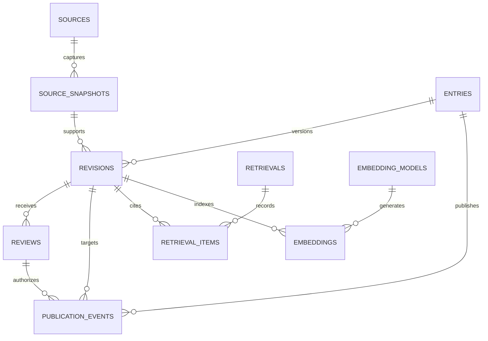

# ProofUI Knowledge Base — PostgreSQL schema proposal

Status: proposed, not connected to the application. Target: PostgreSQL 16+;
optional pgvector 0.8+. Existing audit runs and Studio sessions remain in JSON.

## Scope and boundaries

This is a single shared, editorially curated knowledge catalog. It is not yet a
multi-tenant production design. Private customer documents require workspace
ownership, tenant-aware keys, RLS and authorization tests before ingestion.
Database users/roles, authenticated reviewer identity, migration execution and
object-storage provisioning are deployment work, not included here.

Deterministic code remains authoritative for measurements, thresholds, exceptions
and audit status. Retrieved guidelines may explain evidence or suggest corrections;
they cannot override audit results. No migration writes to the current app stores.

## Entity relationships



| Table | Responsibility |
|---|---|
| `sources` | Stable source identity and canonical URL |
| `source_snapshots` | Immutable upstream ref, artifact URI, SHA-256 and license notice |
| `entries` | Stable knowledge identity, e.g. `uipro:ux:104` |
| `revisions` | Immutable content, applicability, original record and citations |
| `reviews` | Append-only approval/rejection with reviewer and rationale |
| `publication_events` | Explicit publication or withdrawal; approval must match revision |
| `retrievals` | Query configuration, retriever/prompt versions and generation linkage |
| `retrieval_items` | Exact revisions retrieved, rank, scores and prompt inclusion |
| `embedding_models` | Provider/model revision, dimensions and preprocessing identity |
| `embeddings` | Rebuildable vectors keyed by revision and embedding model |

## Content contract

- One revision contains a complete guideline/profile, including exceptions and
  limitations. Do not split a recommendation away from its applicability.
- `kind`: `standard`, `heuristic`, `style`, or `implementation`. Imported Pro Max
  summaries start as heuristics unless reviewed against a primary standard.
- `rule_ids`: current ProofUI IDs such as `text-contrast`, `non-text-contrast`,
  `target-size`, `reflow`, `text-spacing`. Empty means unmapped, never universal.
- `platforms` / `stacks`: normalized tags, e.g. `web`, `ios`, `android`, `react`,
  `nextjs`. Use explicit `all` for a verified universal scope; empty means unknown.
- `applicability`: structured conditions such as product types, WCAG criteria,
  conformance levels, runtime constraints and exceptions. Define and validate
  this object with Zod in the future importer; SQL currently enforces object shape.
- `citations`: nonempty array of `{url, locator, relationship}` objects. A source
  citation establishes provenance, not that a claim has been scientifically verified.
- `raw_record`: original CSV row, including upstream JSON decision rules as data.
  Never evaluate upstream text as code or allow it to override system instructions.
- `upstream_confidence`: nullable source assertion, never retrieval probability.
  Preserve missing values as NULL; do not synthesize a confidence score.
- `upstream_severity`: source label, not ProofUI P0–P3 priority.
- `content_sha256`: application-generated hash of canonical serialized editorial
  fields including applicability and citations; exclude IDs, timestamps and index.
  `source_snapshots.sha256` hashes exact artifact bytes. Importer verifies both.

For multiple supporting sources, citations can reference additional snapshot IDs;
the first schema version does not enforce those JSON references with foreign keys.
Add a normalized revision-source link table when cross-source synthesis is needed.

## Lifecycle

1. Archive the source and retain its license notice; register a source snapshot.
2. Parse/normalize rows, validate schema, deduplicate and create unpublished revisions.
3. Record review of the exact revision. Corrections create a new revision.
4. Append a `publish` event referencing an approved review of that revision.
5. Retrieval reads ONLY `knowledge.published_revisions`.
6. Append `withdraw` to remove an entry from retrieval. Publishing an older approved
   revision provides an explicit rollback. Old citations remain resolvable.

Reviews alone do not change publication. A rejection after publication must be
paired with withdrawal in the same application transaction. Production role grants
must prevent a normal importer/retriever from bypassing editorial publication.
Triggers prevent UPDATE/DELETE of content history; privileged administrators can
still alter the schema. This is not tamper-proof audit storage.

Publication sequences define event ordering, not wall-clock commit ordering. The
publisher should lock the entry before inserting the event within its transaction.
Concurrent revision allocation similarly locks the entry before choosing max+1;
the unique constraint is the final guard and conflicts must be retried.

## Retrieval

First select published revisions and filter rule/platform/stack applicability.
Then retrieve lexical and, optionally, semantic candidates. Merge ranks (e.g.
reciprocal rank fusion), deduplicate by revision and enforce a context token budget.
Abstain when no applicable knowledge is found. Exact rule matches must be usable
even if there is no lexical match.

Example lexical branch (parameters must be bound by the database client):

```sql
SELECT id, title, recommendation,
       ts_rank_cd(search_document, websearch_to_tsquery('english', $1)) AS score
FROM knowledge.published_revisions
WHERE rule_ids @> ARRAY[$2]::text[]
  AND platforms && ARRAY['web', 'all']::text[]
  AND search_document @@ websearch_to_tsquery('english', $1)
ORDER BY score DESC, id
LIMIT $3;
```

This is PostgreSQL lexical ranking, not BM25. The stored generated English
`tsvector` and GIN index support the currently English corpus. They do not solve
Thai segmentation or Thai-to-English matching. Evaluate multilingual embeddings
against real Thai/English queries before enabling semantic retrieval.

Embeddings are optional and dimension-checked against their registered model.
Queries must select ONE model ID and join published revisions before ranking.
Model versions and preprocessing are immutable; switching models creates new rows.
Do not mix distances across different embedding spaces. Start with exact cosine
search; model-specific fixed-dimension partial HNSW indexes need a later migration
and recall testing, particularly after metadata filtering.

Log the final context selection before generation, then attach `generation_id`.
Use score JSON keys such as `lexical`, `cosine_distance`, `rrf`; these are relevance
signals, not evidence confidence. Do not log complete audited page text by default.
Define retrieval-log retention separately from permanent knowledge history.
These logs trace sources/configuration; they do not guarantee identical AI output.

## Initial import mapping

| Upstream | Initial mapping |
|---|---|
| `ux-guidelines.csv` | One entry per `No`; heuristic; explicit rule mapping after review |
| `ui-reasoning.csv` | One entry per `No`; heuristic; product applicability |
| `products.csv` | Separate profile entries; link by category during retrieval |
| Relevant stack CSVs | `implementation`, explicit stack/platform |
| Styles/colors/typography | Later import; style guidance, never an automatic failure |

Snapshot observed locally: `e59ff376a41f7ca47b7541ad5c116495cbade3ee`.
Do not import downloaded data into published state automatically. Missing confidence,
subjective anti-patterns, deprecated styles and numeric examples need review.

## Apply and validate

Run `db/migrations/001_knowledge.sql` once with `psql -v ON_ERROR_STOP=1` on an
isolated development database. Apply `002_knowledge_vectors.optional.sql` only
when pgvector is installed and vector search is being evaluated. Both files are
transactional and intentionally fail on duplicate application; a future migration
runner must track applied versions. No database or extension is provisioned here.

Acceptance checks before application integration:

1. Reject invalid confidence, duplicate revision numbers and missing source refs.
2. Reject changes/deletions to revisions, snapshots, reviews and publication events.
3. Reject publication with absent/rejected review or a review for another revision.
4. Verify imports/reviews alone do not appear in `published_revisions`.
5. Verify publish, replace, withdraw and rollback preserve historical citations.
6. Verify embedding dimensions/model isolation and exclude withdrawn revisions.
7. Compare retrieval relevance, wrong-platform rate, latency and prompt size using
   a fixed set of annotated Thai/English queries and existing audit fixtures.

Validation in this session: reviewed against current application schemas and
PostgreSQL/pgvector documentation. Live migration execution is pending: PostgreSQL
tools are unavailable and the Docker daemon is not running.

References:
- https://www.postgresql.org/docs/current/textsearch-tables.html
- https://github.com/pgvector/pgvector
